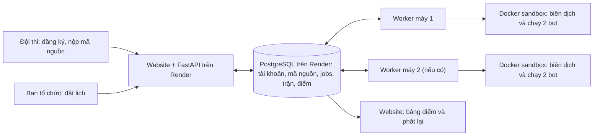

# OTTv2 — cuộc thi lập trình bot Oẳn Tù Tì

Đây là website tổ chức cuộc thi **lập trình bot**, không phải trò chơi mà hai người bấm Đấm/Kéo/Lá trực tiếp. Mỗi đội đăng ký tài khoản, nộp mã nguồn Python 3 hoặc C++17 **trong từng ngày muốn dự thi**. Khi đến lịch do ban tổ chức đặt, hệ thống tự chọn các đội có bot nộp trong ngày và biên dịch thành công, ghép cặp ngẫu nhiên và cho hai chương trình đấu trên bàn cờ 9×9. Website hiển thị lịch sử, điểm số và phát lại từng nước đi.

## Xem sản phẩm

| Mục | Địa chỉ |
| --- | --- |
| Website cho đội thi và khán giả | [oantuti-demo.onrender.com](https://oantuti-demo.onrender.com/) |
| Trang ban tổ chức | [oantuti-demo.onrender.com/admin](https://oantuti-demo.onrender.com/admin) |
| Repository | [Ppt05/Laptrinhmang_G8](https://github.com/Ppt05/Laptrinhmang_G8) |

**Đăng nhập trang ban tổ chức:** tên đăng nhập `admin`.  mật khẩu admin và Render External Database URL trong file `team-access.env` 

Trang quản trị **đặt giờ mở/đóng, xem worker và kết quả**. Quản trị viên không chọn thủ công đội nào gặp đội nào hoặc trận chạy trên máy nào. Dự án hiện triển khai website/API và PostgreSQL trên Render; chương trình chấm trận (**worker**) chạy trên máy của ban tổ chức có Docker Desktop. Không có frontend Vercel, Redis, Judge0 hoặc Piston trong cấu hình hiện tại.

## Hệ thống hoạt động thế nào?



1. **Đăng ký và nộp bài.** API lưu tài khoản và mã nguồn vào PostgreSQL, rồi thêm một job biên dịch vào bảng `jobs`. Một đội được nộp **một lần mỗi ngày theo giờ Việt Nam**, kể cả khi mã không biên dịch được. Giới hạn mỗi bài là **100 KB**.
2. **Biên dịch.** Worker rảnh lấy job từ PostgreSQL, dùng Docker sandbox để kiểm tra/biên dịch. Bài thành công có trạng thái `ready`; bài lỗi có trạng thái `failed` và hiện thông báo lỗi trong tài khoản đội.
3. **Ghép trận tự động.** Khi lịch thi đang mở và qua giờ bắt đầu trong ngày, worker đợi các bài đã nộp hôm nay biên dịch xong, rồi chỉ lấy bài `ready` **đã nộp trong chính ngày đó theo giờ Việt Nam**. Worker xáo trộn các đội hợp lệ và ghép từng cặp. Mỗi ngày chỉ tạo **một lượt ghép tự động**; đội lẻ hoặc đội không nộp trong ngày nghỉ lượt và không được cộng điểm. Nếu chưa đủ hai bot hợp lệ, worker tiếp tục chờ. Khi lượt ghép đã tạo, hệ thống khóa nộp bài đến ngày sau. Đội đã có trận tính điểm trong ngày, kể cả thách đấu hoặc đấu lại, không được ghép thêm. Bài `ready` từ hôm trước không được dùng cho lượt ghép mới; mã nguồn cũ vẫn lưu để xem lịch sử trận đã tạo.
4. **Chạy trận.** Mỗi trận là một job chung. Worker nào rảnh thì nhận trước; không chia cố định đội theo máy. Worker chạy hai bot trong hai Docker sandbox, gửi trạng thái bàn cờ cho bot theo từng lượt, kiểm tra nước đi, tính thắng/hòa/thua và ghi diễn biến vào PostgreSQL.
5. **Công bố kết quả.** Website đọc dữ liệu đã lưu để hiện lịch sử đấu, bảng xếp hạng theo toàn mùa hoặc ngày ghép trận và cửa sổ **Xem trận**. Phần xem trận dựng lại bàn cờ từ danh sách nước đi, **không phải video lấy từ Docker và không truyền trực tiếp trận đang chạy**.

Một worker có thể xử lý toàn bộ hàng đợi, lần lượt từng job. Hai hoặc ba worker với `WORKER_ID` khác nhau và cùng kết nối PostgreSQL có thể xử lý các job song song. PostgreSQL khóa job khi nhận việc để hạn chế hai máy lấy cùng một job. Worker báo nhịp hoạt động định kỳ; nếu một máy mất kết nối khi đang làm, job có thể được đưa lại vào hàng chờ sau khoảng một phút. Kết quả từ worker đã mất quyền xử lý không được ghi đè kết quả của worker mới.

**Lịch không tự bật Docker Desktop.** Máy worker phải đang mở, Docker Desktop và Internet phải hoạt động. Nếu không có worker, website vẫn có thể nhận bài và hiển thị dữ liệu cũ, nhưng job mới sẽ chờ. Dòng “Đang mở” trên website cho biết lịch và cờ cấu hình cho phép thi; hãy xem danh sách worker trực tuyến ở trang admin để xác nhận máy chấm thực sự đang chạy.

### Ví dụ một ngày thi

- Admin đặt lịch từ 20:40 ngày 14/10 đến 20:40 ngày 22/10 (giờ Việt Nam) và bật thi đấu.
- Hai đội nộp bot trong ngày và có trạng thái `ready`. Sau 20:40 mỗi ngày trong khoảng lịch, worker tạo cặp ngẫu nhiên. Nếu worker bật muộn hơn giờ đó, nó tạo lượt khi kết nối lại, miễn là ngày ấy chưa từng tạo lượt ghép tự động.
- Trận hoàn tất được cộng điểm và xuất hiện trong **Xem trận**. Trận phát sinh từ API thách đấu (nếu sử dụng) cũng tính điểm và chiếm lượt thi trong ngày; hệ thống hiện **không có chế độ luyện tập riêng**.

## Đội thi cần làm gì?

1. Vào website, **đăng ký tên đội và mật khẩu** rồi đăng nhập. Không cần mã cuộc thi.
2. Trong **mỗi ngày muốn thi**, chọn Python hoặc C++, dán mã nguồn bot và nộp. Theo dõi trạng thái `Đang chờ → Sẵn sàng` hoặc lỗi biên dịch trong tài khoản. Một đội chỉ được nộp một lần trong ngày, kể cả bài lỗi. Sau nửa đêm giờ Việt Nam, bài hôm trước hết quyền dự lượt ghép mới; đội phải nộp lại nếu muốn thi tiếp.
3. Đợi hệ thống ghép trận theo lịch; thành viên không cần online để bấm nước đi. Xem lịch sử, bảng xếp hạng và phát lại sau khi trận kết thúc.

Bot nhận **một dòng JSON trên `stdin` mỗi lượt**, gồm `side`, `pieces`, `move_number` và `legal_moves`. Bot phải chọn một nước trong `legal_moves` rồi in **đúng một dòng JSON** ra `stdout`, ví dụ:

```json
{"piece_id":"S01","to":"a4"}
```

Bot nên `flush` sau khi in. Chỉ in câu trả lời giao thức ra `stdout`; thông tin gỡ lỗi ghi vào `stderr`. Mỗi lượt có tối đa **1,5 giây** để trả lời; lượt đầu của mỗi bot có tối đa **15 giây** để khởi động. Dòng trả lời thiếu/sai, nước đi không hợp lệ, bot tự thoát hoặc quá giờ khiến bot thua trận. Xem [bot Python mẫu](examples/bot_greedy.py) và [bot ngẫu nhiên](examples/bot_random.py).

### Luật OTTv2 đang được code áp dụng

- Bàn cờ 9×9, mỗi bên bắt đầu với 10 quân thuộc ba loại Đấm (`rock`), Kéo (`scissors`), Lá (`paper`). Xanh/`south` đi trước, Hồng/`north` đi sau.
- Mỗi lượt một quân đi đúng một ô theo một trong tám hướng. Đấm ăn Kéo, Kéo ăn Lá, Lá ăn Đấm. Quân đồng đội hoặc quân đối phương mà quân đi không khắc chế được sẽ chặn ô; **hòa loại không được ăn và không đi vào ô đó**.
- Thắng khi đưa một quân đến ô đích (Bắc đến `a1`, Nam đến `i9`) hoặc ăn hết **một loại quân** của đối thủ.
- Hòa nếu cùng thế cờ lặp ba lần, bên đến lượt không còn nước hợp lệ, hoặc chạm giới hạn mặc định **200 nước đi**.
- Thắng: **1 điểm**; hòa: **0,5 điểm mỗi đội**; thua: **0 điểm**. Bảng toàn mùa cộng các trận `done`; bộ lọc theo ngày dùng **ngày ghép trận**, không nhất thiết là ngày trận kết thúc.

## Cấu trúc mã nguồn

```text
oantuti_server/
├── app/
│   ├── main.py            # FastAPI: website, đăng ký, đăng nhập, nộp bài, kết quả, admin
│   ├── worker.py          # Hàng chờ, ghép đội, biên dịch, chạy trận, luật đi quân
│   ├── game_setup.py      # Thế cờ ban đầu dùng cho trận và phát lại
│   ├── event_schedule.py  # Tính trạng thái lịch theo giờ Việt Nam
│   ├── models.py          # Bảng players, submissions, jobs, matches, event_control, worker_nodes
│   ├── schema.py          # Khởi tạo/nâng cấp cấu trúc PostgreSQL
│   ├── security.py        # Mật khẩu và xác thực đội
│   └── db.py              # Kết nối cơ sở dữ liệu
├── web/                   # Trang người chơi và admin: HTML, CSS, JavaScript
├── sandbox/               # Image Docker biên dịch/chạy mã thí sinh
├── examples/              # Bot mẫu
├── tests/                 # Ca kiểm tra giao thức và luồng chạy worker
├── Dockerfile             # Image website/API
├── Dockerfile.worker      # Image worker
├── docker-compose.yml     # Website + PostgreSQL + worker chạy riêng trên máy local
├── docker-compose.remote-worker.yml  # Worker máy cá nhân kết nối PostgreSQL Render
├── render.yaml            # Blueprint website và database trên Render
├── .env.example           # Mẫu biến môi trường local
└── .env.worker.example    # Mẫu biến môi trường worker nối Render
```

Hàng chờ hiện là **bảng `jobs` trong PostgreSQL**, không dùng Redis. Các bước “match loader”, “runner”, “game engine” nằm trong `app/worker.py`, chưa phải microservice độc lập. Mã bot chạy trong Docker với mạng bị tắt, hệ thống tệp chỉ đọc và giới hạn CPU, bộ nhớ, tiến trình. API trên Render không thực thi mã thí sinh.

## Cách chạy toàn bộ trên một máy để phát triển

Cần **Git, Docker Desktop (Linux containers), PowerShell**. Cách này dùng database local, **không dùng dữ liệu thi trên Render**.

Nếu máy đang chạy worker của cuộc thi thật, hãy thử chế độ local trong **một bản clone và Docker Compose project khác**. Hai tệp Compose đều đặt tên dịch vụ `worker`; chạy cả hai trong cùng project có thể thay thế worker đang kết nối Render.

```powershell
git clone https://github.com/Ppt05/Laptrinhmang_G8.git
cd Laptrinhmang_G8
Copy-Item .env.example .env
notepad .env
```

Trong `.env`, đặt giá trị riêng đủ mạnh cho `POSTGRES_PASSWORD`, `ADMIN_API_KEY`, `ADMIN_PASSWORD`. Muốn chạy trận local, đặt `MATCHES_ENABLED=true`; giữ `AUTO_PAIR_ENABLED=true`. Sau đó:

```powershell
docker compose up --build -d
docker compose ps
```

Mở [website local](http://localhost:8000/) và [admin local](http://localhost:8000/admin). Đăng nhập admin bằng `ADMIN_USERNAME`/`ADMIN_PASSWORD` trong `.env`, đặt lịch mở/đóng. Nộp ít nhất hai bot mẫu từ hai tài khoản khác nhau và chờ hai bài chuyển sang `ready`. Nếu đã qua giờ ghép và lịch đang mở, worker sẽ tạo trận. Xem log bằng `docker compose logs -f api worker` (nhấn Ctrl+C để thoát màn hình log); dừng bằng `docker compose down`. **Không thêm `-v`** nếu muốn giữ dữ liệu local.

## Cách vận hành website Render và worker trên máy ban tổ chức

Repository đã có `render.yaml` cho Web Service và PostgreSQL. Với hệ thống đang chạy ở link đầu README, **không cần tạo thêm Render service**. Kiểm tra trong Render Web Service:

- `DATABASE_URL`: kết nối tới PostgreSQL của dự án; Render Blueprint cấu hình biến này.
- `ADMIN_USERNAME=admin`, `ADMIN_PASSWORD`: thông tin đăng nhập trang ban tổ chức. Đặt mật khẩu trong Render Environment và chia cho thành viên nhóm qua kênh riêng. `ADMIN_API_KEY` là khóa API quản trị và khóa ký phiên đăng nhập, phải giữ riêng trong Render Environment.
- `MATCHES_ENABLED=true`: cho API nhận trạng thái thi đấu theo lịch. `render.yaml` mặc định đặt `false` khi tạo mới, nên phải kiểm tra giá trị thực tế trên Render.
- `REGISTRATION_OPEN=true`: cho phép đội đăng ký.

Trên **mỗi máy worker**:

```powershell
git clone https://github.com/Ppt05/Laptrinhmang_G8.git
cd Laptrinhmang_G8
Copy-Item .env.worker.example .env.worker
notepad .env.worker
```

Lấy **External Database URL** từ trang PostgreSQL trong Render Dashboard, dán vào `DATABASE_URL` trong `.env.worker` (máy cá nhân không dùng Internal URL). Đặt `MATCHES_ENABLED=true`, `AUTO_PAIR_ENABLED=true`. Máy thứ nhất dùng `WORKER_ID=may-1`, máy thứ hai dùng `may-2`, máy thứ ba dùng `may-3`; mỗi máy có **ID riêng** nhưng cùng URL database. File này chứa bí mật, chỉ lưu trên máy ban tổ chức.

**Dùng file cấu hình do trưởng nhóm gửi riêng:** sau khi clone repo và nhận `team-access.env`, lưu file đó vào thư mục gốc repository rồi chạy `Copy-Item team-access.env .env.worker`. Trong `.env.worker`, sửa `WORKER_ID` thành ID riêng của máy này trước khi bật worker. File đã có `DATABASE_URL`, `ADMIN_USERNAME` và `ADMIN_PASSWORD`. Nếu máy đã có `.env.worker` đang chạy tốt, giữ file hiện tại và chỉ đối chiếu thông tin cần thiết; không chép đè. `git pull` không tải file `team-access.env`. Nếu Render đổi mật khẩu database hoặc admin, trưởng nhóm cần gửi file mới và mọi máy worker cần cập nhật URL.

Mở Docker Desktop, chờ Engine sẵn sàng rồi chạy:

```powershell
docker compose -f docker-compose.remote-worker.yml up --build -d
docker compose -f docker-compose.remote-worker.yml ps
docker compose -f docker-compose.remote-worker.yml logs -f worker
```

Ở trang admin, kiểm tra worker hiện **trực tuyến**, lưu giờ mở/đóng và quan sát trận. Nếu chỉ còn một máy, máy đó vẫn nhận mọi job đang chờ. Muốn dừng một worker:

```powershell
docker compose -f docker-compose.remote-worker.yml down
```

Không để Windows Sleep trong lúc thi. Máy bạn khác có thể thay máy hỏng bằng cách clone repo, lấy **URL database từ người quản trị Render qua kênh riêng**, đặt một `WORKER_ID` chưa được dùng và chạy các lệnh trên. Không chia sẵn đội hoặc trận cho từng máy.

### Cập nhật phiên bản

- **Website/API trên Render:** đẩy commit lên `main`; kiểm tra mục Deploys của Web Service. Nếu Auto Deploy đang tắt hoặc không nhận commit, dùng **Manual Deploy → Deploy latest commit**.
- **Worker trên từng máy:** `git pull --ff-only origin main`, rồi `docker compose -f docker-compose.remote-worker.yml up --build -d`. Đẩy GitHub hoặc deploy Render **không tự cập nhật worker đang chạy trên máy cá nhân**. Nên cập nhật khi không có job đang chạy.
- **Dữ liệu thi:** nằm trong PostgreSQL trên Render, không nằm trong GitHub. Tệp bot sau biên dịch được worker giữ trên volume Docker riêng; worker máy khác có thể biên dịch lại từ mã nguồn đã lưu trong database.

## Kiểm tra và xử lý sự cố

| Dấu hiệu | Kiểm tra đầu tiên |
| --- | --- |
| Bài nộp đứng ở `queued` | Docker Desktop, `docker compose ... ps`, log worker, External Database URL |
| Lịch báo mở nhưng chưa có trận | Ít nhất hai đội đã nộp bài **hôm nay** và có trạng thái `ready`? Đã qua giờ ghép trong ngày? Hôm đó đã tạo lượt ghép tự động chưa? |
| Worker không hiện trực tuyến | `WORKER_ID` có trùng máy khác không? Docker/Internet/URL database có hoạt động không? |
| Trận `failed` | Xem log worker và trạng thái sandbox; đây có thể là lỗi hạ tầng, không tự tính điểm |
| Bot thua ngay nước đầu | Xem giao thức `stdin/stdout`, newline/flush, `legal_moves`, giới hạn thời gian |
| Website chưa hiện mã mới | Xem commit đang Live trong Render Deploys; worker phải cập nhật riêng |

Khi **một trận đã kết thúc sai vì lỗi hạ tầng**, admin phải nhập lý do hủy. Nếu cả hai bài được nộp trong ngày hiện tại và hai đội chưa có trận khác hôm nay, admin có thể **Hủy điểm, đấu lại** bằng đúng hai phiên bản đó; trận đấu lại chiếm lượt thi trong ngày. Với trận cũ hoặc đội đã có trận khác hôm nay, admin chỉ có thể **Hủy điểm** và không chạy lại bằng mã hôm trước. Trận bị hủy vẫn lưu để tra cứu nhưng không tính điểm. Không sửa âm thầm kết quả.

## Lưu ý về bí mật và phạm vi hiện tại

- `.env`, `.env.worker` và `team-access.env` được Git bỏ qua. Repository này đang Public; người có link đều đọc được file đã push và lịch sử Git. Tài khoản admin có quyền thay đổi lịch và hủy điểm trận, nên chỉ gửi file cấu hình cho người phụ trách.
- Worker có quyền truy cập Docker socket trên máy chạy nó; chỉ cài trên máy đáng tin cậy của ban tổ chức.
- Website có API `/api/challenges` cho thách đấu trực tiếp trong giờ mở thi. Cả hai đội phải có bài `ready` nộp hôm nay và chưa có trận nào khác trong ngày; trận thách đấu được tính vào bảng điểm. Giao diện hiện tập trung vào lượt **ghép ngẫu nhiên theo ngày**. Không có chế độ “đấu thử không tính điểm”.
- Tài liệu này mô tả code trong repository. Trước ngày thi, kiểm tra commit đang Live trên Render và phiên bản worker của từng máy vì hai phần được triển khai riêng.
