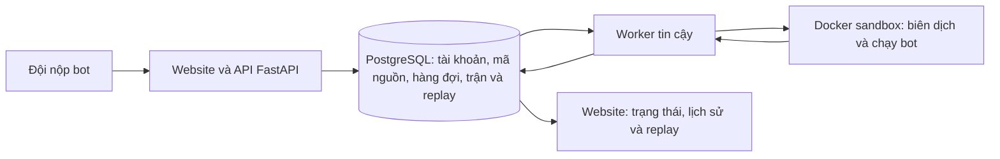

# RPS Code Clash

**RPS Code Clash • Đấu trường thuật toán Kéo-Búa-Bao** là website để các đội viết bot chơi OTTv2 trên bàn cờ 9×9. Người chơi nộp chương trình Python 3 hoặc C++17; hệ thống kiểm tra bot, xếp trận và lưu kết quả cùng replay.

> **Chế độ hiện tại:** Tournament và Practice hoạt động; Daily đã triển khai, mặc định tắt và được bật tại trang admin. Challenge chưa triển khai.
>
> Daily cho phép tối đa 5 lượt nộp bot và 5 trận/ngày/đội theo UTC+7. Đội chọn bot sẵn sàng rồi chủ động tìm trận; nộp bot không tự vào hàng chờ. Bảng Daily xếp theo Elo, điểm Daily để tham khảo.
>
> Xem [hướng dẫn Daily](DAILY.md) và [luật thi đấu](GAMERULE.md) để biết chi tiết.

## Website

| Khu vực | Địa chỉ |
| --- | --- |
| Website người chơi và khán giả | https://oantuti-demo.onrender.com/ |
| Trang ban tổ chức | https://oantuti-demo.onrender.com/admin |
| Mã nguồn | https://github.com/Ppt05/Laptrinhmang_G8 |

> Liên kết trên là địa chỉ triển khai đã cấu hình trong dự án. Trạng thái và tính năng đang hoạt động phụ thuộc commit được deploy trên Render.

**Đăng nhập trang ban tổ chức:** tên đăng nhập mặc định là `admin`. Dùng mật khẩu trong file `team-access.env` do nhóm cung cấp riêng; trên Render, giá trị tương ứng được cấu hình bằng `ADMIN_PASSWORD` trong Environment của Web Service. File cấu hình riêng có thể còn chứa thông tin kết nối database, vì vậy không đăng tải công khai hoặc commit file đó.

## Chế độ thi đấu

### Tournament

Trong tab **Tournament** của trang BTC, phần **Điều hành vòng thi** có danh sách **Worker chạy vòng này**. Chọn một worker trực tuyến đã cập nhật rồi bấm **Lưu worker**; lựa chọn áp dụng cho kiểm tra bot và các ván của vòng, được kế thừa ở vòng kế tiếp. Mặc định tự chọn giữa các worker hỗ trợ điều khiển vòng. Worker cũ được đánh dấu cần cập nhật và không nhận job Tournament mới. Khi worker đã chọn ngoại tuyến, công việc chờ đúng máy đó, không tự chuyển sang worker khác.

Bấm **Dừng vòng** trước khi đổi worker đang chạy. Hệ thống dừng nhận job mới cho vòng, thu hồi quyền ghi kết quả của job chưa xong, giữ nguyên ván hoàn tất và lịch sử lần chạy. Kết quả trả muộn từ job bị thu hồi không được tính. Chọn và lưu worker mới, rồi bấm **Tiếp tục vòng** để chạy lại riêng công việc chưa hoàn tất bằng bot và cấu hình đã khóa. Hold/khiếu nại khác và lỗi hạ tầng vẫn cần xử lý riêng. Dừng vòng không tự gia hạn cửa sổ nộp hoặc đổi kết quả đã chốt.

Khi nâng cấp, cập nhật API và ít nhất một worker trước khi chạy Tournament. Migration thêm `jobs.round_id`, `tournament_rounds.worker_id` và `worker_nodes.round_control_version`, liên kết job Tournament cũ và bảo vệ job đang chờ khỏi worker cũ. Job đã chạy giữ quyền sở hữu cho tới khi hoàn tất hoặc BTC dừng vòng. Các job Tournament mới dùng `tournament_queued` / `tournament_running`; Daily và Practice giữ hàng đợi hiện có. Marker riêng `worker_queue_guard` ngăn scheduler cũ tạo job không có giới hạn worker; marker không phải khiếu nại và không thể được giải phóng bằng Force. Trước khi rollback, dừng các vòng được điều khiển và giữ nguyên các cột/marker; không bật lại worker cũ cho các vòng đó hoặc chuyển job về hàng đợi chung.

Giải Tournament do ban tổ chức tạo và điều hành. Đội cần đăng ký tài khoản, tham gia giải, rồi nộp bot trong cửa sổ của vòng đang mở. Mỗi đội được nộp tối đa ba lần trong một vòng; ban tổ chức khóa bot dùng cho vòng và điều hành các encounter theo thể thức giải. Kết quả hợp lệ được tính điểm và Elo theo luật giải.

Nộp bot Tournament cần có giải, đội đã tham gia và vòng đang mở. Vì vậy, khi chưa có giải hoặc chưa mở vòng, hãy dùng chế độ Practice để gửi bot và luyện tập.

### Practice

Practice hoạt động độc lập với Tournament: không cần giải đang mở. Đội đăng nhập, chọn ngôn ngữ và nộp bot trong mục **Nộp bot để luyện tập**. Worker biên dịch và kiểm tra bot theo giao thức Practice; khi trạng thái chuyển sang **Sẵn sàng**, đội chọn bot đó cùng một bot mẫu của BTC (**First**, **Greedy** hoặc **Random**) rồi bắt đầu một ván.

- Mỗi đội được chấp nhận tối đa **10 trận mỗi ngày**, tính theo giờ Việt Nam (UTC+7).
- Mỗi đội chỉ có thể có một trận Practice đang chờ hoặc đang chạy cùng lúc.
- Practice không cộng điểm giải hoặc Elo. Trận và replay vẫn được lưu trong lịch sử.
- Bot Tournament cũ chỉ hiện để chọn nếu đã `ready` và tương thích với luật, môi trường Practice hiện tại.
- Nếu trận lỗi hạ tầng, có thể chạy lại chính trận đó; retry không tạo thêm lượt quota.

Job Tournament được worker ưu tiên trước công việc Practice. Vì vậy, nếu worker bận, bài Practice có thể ở trạng thái chờ đến khi worker xử lý.

## Thử bot cục bộ — không dùng worker BTC

Chạy hai bot C++17/Python ngay trên máy của bạn, không cần PostgreSQL, tài khoản,
Docker hay dependency pip ở chế độ Native. Cần **Python 3.10+**; C++ cần `g++`
trong PATH hoặc biến môi trường `CXX` trỏ đến compiler tương thích g++.

```powershell
python -m app.local
```

Mở **http://127.0.0.1:8765**. Chọn hai bot mẫu hoặc mở hai file source (ví dụ V2
đấu V1), bấm **Biên dịch & tạo ván**. Dùng **Đi 1 lượt**, **Chạy**, **Tạm dừng**,
**Đổi phía**, xem observation từng nước và stderr. Có thể tải/mở replay JSON;
replay chỉ phát lại dữ liệu đã lưu. Kết quả local không tính Elo và không dùng quota
Practice/Tournament. Link **Thử cục bộ** trên website mở hướng dẫn `/local`.

Native chạy code bằng quyền tài khoản máy bạn: chỉ chạy source của mình hoặc bot
mẫu tin cậy. Native dùng **cùng engine, API callback và schema JSON** với worker;
thời gian tối đa 15 giây ở nước đầu, 1,5 giây/nước sau, 200 nước, nhưng không áp
dụng quota RAM/CPU Docker. Ghi debug bằng `print(..., file=sys.stderr)` hoặc
`std::cerr`; không ghi thêm vào stdout. Hai tiến trình bot giữ biến toàn cục giữa
các nước. Bot random tự quản lý seed của mình; bộ luật có một thế cờ đầu cố định,
không có random map hay cam kết tái hiện hành vi của bot dùng đồng hồ/random.

Để thử trong sandbox tương tự BTC (256 MiB, 1 CPU, không mạng):

```powershell
docker build -f sandbox/Dockerfile -t oantuti-sandbox:dev .
python -m app.local --backend docker
```

Dùng `--image image@sha256:...` để khớp chính xác image giải, `--port 8766` nếu
cổng bận. Local lab chỉ bind `127.0.0.1`, không đọc cấu hình DB/BTC và không gửi
source đi đâu. Máy ở trạng thái sleep hoặc bị tải nặng có thể làm bot timeout.
Tắt local runner bằng Ctrl+C. Trong lúc biên dịch, lệnh dừng có thể cần đợi compiler
hoàn tất (tối đa 35 giây); bot đang chạy được dừng và dọn tiến trình.

Kiểm thử local không cần DB/Docker:

```powershell
python -m unittest tests.test_local -v
```

## Cách một trận được xử lý



Website lưu yêu cầu vào PostgreSQL và tạo job. Worker kết nối cùng database, lấy job theo mức ưu tiên, dùng Docker sandbox để biên dịch/chạy bot, rồi ghi kết quả và nước đi vào database. API trên Render không chạy mã thí sinh. Nếu worker tắt hoặc mất kết nối, job sẽ chờ; bật Docker trên máy khác không tự kết nối tới Render trừ khi worker được cấu hình với External Database URL của đúng database.

Replay được dựng từ các nước đi đã lưu, không phải video trực tiếp. Dữ liệu website triển khai được lưu trong PostgreSQL Render; Docker volume của máy local chứa một database phát triển riêng và không đồng bộ với Render.

## Yêu cầu

- Git
- Docker Desktop với Linux containers và Docker Compose
- PowerShell trên Windows (hoặc shell tương đương)

## Chạy website và worker local

Lệnh dưới đây tạo database local mới. Nó không đọc/ghi database của website Render.

```powershell
git clone https://github.com/Ppt05/Laptrinhmang_G8.git
cd Laptrinhmang_G8
Copy-Item .env.example .env
```

Mở `.env`, thay các giá trị bí mật mẫu như `POSTGRES_PASSWORD`, `ADMIN_API_KEY`, `ADMIN_PASSWORD`. Để thử trận local, đặt `MATCHES_ENABLED=true` và `AUTO_PAIR_ENABLED=true`.

```powershell
docker compose up --build -d
docker compose ps
```

Mở http://localhost:8000/ và trang quản trị http://localhost:8000/admin. Đăng nhập admin bằng `ADMIN_USERNAME` và `ADMIN_PASSWORD` trong `.env`. Đăng ký hai tài khoản đội, nộp bot, rồi dùng Practice để thử hoặc tạo Tournament từ trang admin.

Xem log: `docker compose logs -f api worker`. Dừng các dịch vụ: `docker compose down`. Lệnh này giữ database trong volume; **không thêm `-v`** nếu muốn giữ dữ liệu local.

## Chạy worker cá nhân kết nối website Render

Website và PostgreSQL vẫn chạy trên Render; Docker Desktop trên máy cá nhân chỉ chạy worker. Không dùng cấu hình `docker-compose.yml` cho mục đích này vì cấu hình đó tạo PostgreSQL local.

1. Clone repository trên máy worker và chuẩn bị file cấu hình:

   ```powershell
   git clone https://github.com/Ppt05/Laptrinhmang_G8.git
   cd Laptrinhmang_G8
   Copy-Item .env.worker.example .env.worker
   ```

2. Dùng file cấu hình worker mà nhóm gửi riêng. Nếu file đó tên `team-access.env`, sao chép nó thành `.env.worker` bằng `Copy-Item team-access.env .env.worker`; nếu `.env.worker` đã có cấu hình đang chạy thì **không chép đè**. File này chứa `DATABASE_URL` trỏ tới PostgreSQL Render. Nếu chưa được cấp file, lấy **External Database URL** từ Render Dashboard và đặt vào `DATABASE_URL` trong `.env.worker`. Đặt `WORKER_ID` riêng cho từng máy, ví dụ `may-1`. Không chia sẻ hoặc commit các file cấu hình bí mật.

3. Mở Docker Desktop, bảo đảm Docker Engine hoạt động, rồi chạy:

   ```powershell
   docker compose -f docker-compose.remote-worker.yml up --build -d
   docker compose -f docker-compose.remote-worker.yml ps
   docker compose -f docker-compose.remote-worker.yml logs -f worker
   ```

4. Trong trang admin, kiểm tra worker hiển thị trực tuyến. Worker cần Internet, quyền dùng Docker socket và máy tính không ở trạng thái Sleep. Nếu worker không trực tuyến, các bài mới có thể nằm chờ.

Dừng worker bằng:

```powershell
docker compose -f docker-compose.remote-worker.yml down
```

Worker chạy mã người dự thi bên trong sandbox, vì vậy chỉ vận hành trên máy tin cậy của ban tổ chức. Khi có thay đổi mã, cập nhật repository và dựng lại worker trên từng máy; deploy website trên Render không tự cập nhật worker cá nhân.

## Triển khai Render

`render.yaml` mô tả Web Service Docker cùng PostgreSQL ở khu vực Singapore. Blueprint đặt mặc định `MATCHES_ENABLED=false`, `REGISTRATION_OPEN=true` và tạo các khóa admin tự động. Sau khi tạo hoặc cập nhật service:

1. Kiểm tra `DATABASE_URL` được nối với PostgreSQL dự kiến.
2. Đặt `ADMIN_USERNAME`, `ADMIN_PASSWORD` và `ADMIN_API_KEY` an toàn trong Environment của Web Service. Không ghi bí mật vào README, Git hoặc ảnh chụp công khai.
3. Bật `MATCHES_ENABLED=true` khi muốn cho phép worker xử lý trận theo cấu hình; lịch Tournament còn được điều hành riêng trong admin.
4. Khởi chạy worker trên máy tin cậy theo hướng dẫn ở trên và xác nhận worker trực tuyến.
5. Sau deploy, kiểm tra `/health`, đăng nhập, nộp thử bot và xem log của cả Web Service lẫn worker.

`app/schema.py` tạo các bảng còn thiếu và áp dụng một số thay đổi schema tương thích khi ứng dụng khởi động. Với database Render đang có dữ liệu, hãy sao lưu trước khi thay đổi lớn và kiểm tra deploy thực tế trước sự kiện.

## Giao thức bot

Một bot cần định nghĩa `choose_move(state)` và trả về một nước hợp lệ. `state` có `side`, `move_number`, `board_size`, `pieces` và `legal_moves`. Mỗi nước hợp lệ có `piece_id`, `from`, `to` và `capture`. Ví dụ tối thiểu:

```python
def choose_move(state):
    return state["legal_moves"][0]
```

Xem [bot Python First](examples/bot_first.py), [bot Python Greedy](examples/bot_greedy.py) và [bot Python Random](examples/bot_random.py). Với Tournament, giao diện có mã khởi đầu theo ngôn ngữ và môi trường của vòng. Giới hạn mã nguồn hiện tại là 100.000 byte. Thời gian mỗi nước, thời gian khởi động và giới hạn sandbox được định nghĩa trong code và bản chụp môi trường của giải.

## Cấu trúc repository

```text
app/                              API, database, luật, worker và Tournament
web/                              Giao diện người chơi và ban tổ chức
examples/                         Bot mẫu Practice
sandbox/                          Image chạy bot biệt lập
tests/                            Kiểm thử
Dockerfile                        Image website/API
Dockerfile.worker                 Image worker
docker-compose.yml                Website + PostgreSQL + worker local
docker-compose.remote-worker.yml  Worker kết nối PostgreSQL Render
render.yaml                       Blueprint Render
GAMERULE.md                       Luật OTTv2 và thể thức giải chi tiết
.env.example                      Cấu hình mẫu cho local
.env.worker.example               Cấu hình mẫu cho worker từ xa
```

## Xử lý sự cố

| Triệu chứng | Kiểm tra |
| --- | --- |
| Practice hoặc bài nộp cứ chờ | Worker có trực tuyến trong admin không? Kiểm tra Docker Engine, log worker và `DATABASE_URL` trong `.env.worker`. |
| Không chọn được bot Practice | Bot phải có trạng thái `Sẵn sàng`; bài mới nộp cần worker biên dịch xong. Bot Tournament cũ phải tương thích luật và môi trường Practice hiện tại. |
| Không nộp được Tournament | Kiểm tra đội đã đăng nhập và tham gia giải, vòng đã mở, còn hạn nộp và chưa vượt số lần nộp của vòng. Nếu chưa mở giải, chuyển sang Practice. |
| Practice báo đang có trận hoạt động | Chờ trận queued/running hoàn tất; một đội chỉ có tối đa một trận Practice đang hoạt động. |
| Đăng nhập hoặc trạng thái tài khoản local khác Render | Đó là hai PostgreSQL tách biệt. Dùng cùng một database chỉ khi chủ động cấu hình worker từ xa bằng External Database URL. |
| Website có mã mới nhưng worker chạy mã cũ | Cập nhật Git và dựng lại container worker trên máy đang xử lý job. |

## Tài liệu liên quan

- [Luật OTTv2, Tournament, Practice và tính điểm](GAMERULE.md)
- [Hướng dẫn triển khai Render](DEPLOY_RENDER_FREE.md)
