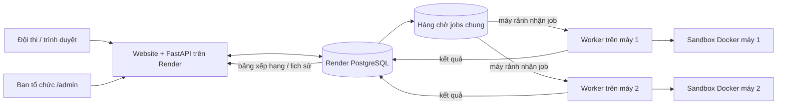

# Oẳn Tù Tì OTTv2 — thi đấu bằng bot

Website tổ chức cuộc thi lập trình bot cho game OTTv2 trên bàn cờ 9×9. Mỗi đội đăng ký tài khoản, nộp chương trình bằng Python hoặc C++17; hệ thống tự chạy hai bot trong trận và lưu kết quả. Người chơi không cần trực tuyến khi bot thi đấu.

## Liên kết sản phẩm

- **Website cuộc thi:** [https://oantuti-demo.onrender.com/](https://oantuti-demo.onrender.com/)
- **Trang quản trị lịch thi:** [https://oantuti-demo.onrender.com/admin](https://oantuti-demo.onrender.com/admin)

Trang quản trị yêu cầu đăng nhập. Không ghi mật khẩu thật, `ADMIN_API_KEY`, token đội hoặc URL cơ sở dữ liệu vào README/GitHub. Muốn người khác quản trị, hãy chia sẻ thông tin đăng nhập qua cách riêng tư; người chỉ chạy worker không cần mật khẩu admin.

## Kiến trúc đang chạy



Render chạy website/API và PostgreSQL. Mỗi worker chạy trên một máy có Docker Desktop, có mã `WORKER_ID` riêng và kết nối tới cùng PostgreSQL trên Render. Admin chỉ đặt thời gian mở và đóng thi đấu. Trong khung giờ đó, hệ thống tự ghép ngẫu nhiên các đội có bot hợp lệ mỗi ngày. Trận vào hàng chờ chung; máy rảnh lấy trận đầu tiên đang chờ. Nếu chỉ một máy bật, máy đó nhận toàn bộ trận chờ, lần lượt từng trận.

### Worker thực tế so với sơ đồ module

Sơ đồ có Job Queue, Match Worker, Job Handler, Match Loader, Sandbox Manager, Match Runner, Game Engine và Result Collector mô tả đúng **các trách nhiệm về mặt khái niệm**. Trong phiên bản hiện tại, chúng chưa phải tám dịch vụ riêng: một tiến trình Python trong `app/worker.py` đọc bảng `jobs` ở PostgreSQL, biên dịch bài, tạo trận, kiểm tra luật, gọi sandbox và ghi kết quả vào cơ sở dữ liệu. Hàng đợi là bảng `jobs` trong PostgreSQL, **không phải Redis**. Sandbox Python/C++ là container Docker riêng cho mỗi bot; API và worker không chạy mã bot trực tiếp.

Luồng xử lý:

1. Đội đăng ký/đăng nhập trên website và gửi mã nguồn bot. API lưu tài khoản, bài nộp và job biên dịch vào PostgreSQL.
2. Worker lấy job chưa xử lý, biên dịch/kiểm tra bot trong sandbox. Artifact đã biên dịch được lưu trong volume Docker riêng của từng máy.
3. Khi lịch đang mở và đến giờ bắt đầu hằng ngày, worker ghép ngẫu nhiên các đội có bot đã biên dịch thành công: mỗi đội tối đa một trận ghép tự động/ngày; đội lẻ nghỉ lượt. Hai job ví dụ có thể là đội 1–2 và đội 3–4. `may-1` và `may-2` cùng lấy job đang chờ. PostgreSQL khóa job để mỗi trận chỉ một máy nhận. Nếu chỉ `may-1` bật, máy đó xử lý cả hai trận lần lượt. Nếu thiếu artifact trên máy nhận trận, worker tự biên dịch lại từ mã nguồn đã lưu trong PostgreSQL, rồi chạy hai bot và kiểm tra luật OTTv2.
4. Worker ghi trận, diễn biến, điểm và đội thắng vào PostgreSQL; website đọc dữ liệu đó để hiển thị lịch sử và bảng xếp hạng.

Website hiển thị `Đang mở` khi cấu hình cho phép và nằm trong khung giờ. Điều đó **không tự chứng minh máy worker đang hoạt động**. Nếu worker tắt, job sẽ nằm chờ hoặc trận không chạy. Chỉ để `MATCHES_ENABLED=true` khi đã bật worker.

## Cấu trúc mã nguồn

```text
oantuti_server/
├── app/
│   ├── main.py             # API đăng ký/đăng nhập, nộp bot, trận, bảng điểm, lịch admin
│   ├── worker.py           # Hàng đợi, biên dịch, ghép trận, luật/game runner, ghi kết quả
│   ├── models.py           # Bảng PostgreSQL: đội, bài nộp, job, trận, lịch
│   ├── db.py               # Kết nối và session SQLAlchemy
│   ├── schema.py           # Tạo và cập nhật bảng PostgreSQL
│   ├── event_schedule.py   # Trạng thái lịch theo giờ Việt Nam
│   └── security.py         # Token đội và kiểm tra quyền
├── web/
│   ├── index.html          # Website cuộc thi
│   ├── app.js, app.css     # Đăng nhập, nộp bot, lịch sử, bảng xếp hạng
│   └── admin.html/js/css  # Trang admin đặt giờ và mở/đóng lịch
├── sandbox/
│   ├── Dockerfile          # Môi trường chạy bot cô lập
│   └── entrypoint.py       # Biên dịch và khởi chạy Python/C++ trong sandbox
├── examples/               # Bot ví dụ
├── Dockerfile              # Image website/API
├── Dockerfile.worker       # Image worker
├── docker-compose.yml      # Chạy toàn bộ hệ thống local
├── docker-compose.remote-worker.yml # Chỉ chạy worker nối tới Render
├── render.yaml             # Blueprint website + PostgreSQL trên Render
├── .env.example            # Mẫu cấu hình local
└── .env.worker.example     # Mẫu cấu hình worker nối Render
```

## Đưa hai link lên GitHub

Hai link ở đầu README sẽ hiện ngay trên trang repository. GitHub mục **About → Website** chỉ nhận một địa chỉ; đặt link website cuộc thi ở đó. Link trang admin vẫn để trong README như trên.

Để đặt link website trong About: mở trang repository → khung **About** bên phải → bấm biểu tượng bánh răng → điền `https://oantuti-demo.onrender.com/` vào **Website** → **Save changes**. README cung cấp cả website và trang quản trị cho người xem.

## Chạy website, API, PostgreSQL và worker trên máy cá nhân

Đây là một bộ dữ liệu local riêng, không phải dữ liệu cuộc thi đang lưu trên Render.

### Cần chuẩn bị

- Git và Docker Desktop đã cài trên Windows.
- Mở Docker Desktop, chờ Docker Engine báo đang chạy; dùng Linux containers.
- Mở PowerShell tại thư mục chứa `docker-compose.yml`.

### Cài và chạy

```powershell
git clone https://github.com/Ppt05/Laptrinhmang_G8.git
cd Laptrinhmang_G8
Copy-Item .env.example .env
notepad .env
docker compose up --build -d
```

Trong `.env`, thay `POSTGRES_PASSWORD`, `ADMIN_API_KEY` và `ADMIN_PASSWORD` bằng giá trị riêng, khó đoán; giữ `ADMIN_USERNAME=admin`. Đặt `MATCHES_ENABLED=true` để chạy trận local và giữ `WORKER_ID=may-1`. `.env` bị Git bỏ qua; không tải file này lên GitHub.

Mở [http://localhost:8000/](http://localhost:8000/) để đăng ký hai đội và nộp bot. Vào [http://localhost:8000/admin](http://localhost:8000/admin) để đăng nhập bằng `ADMIN_USERNAME`/`ADMIN_PASSWORD` trong `.env`, đặt giờ mở và đóng thi đấu. Chế độ ghép tự động hằng ngày mặc định bật (`AUTO_PAIR_ENABLED=true`).

```powershell
docker compose ps
docker compose logs -f api worker
```

`Ctrl+C` chỉ thoát xem log, không dừng dịch vụ. Dừng các container bằng `docker compose down`. Lệnh đó giữ dữ liệu trong volume; **không dùng `docker compose down -v` nếu muốn giữ database local**.

## Chạy worker trên máy ban tổ chức để phục vụ website Render

Đây là cấu hình đang dùng cho cuộc thi online: website và database ở Render, worker trên máy có Docker Desktop. Người chơi vẫn vào link Render; không cần truy cập máy worker.

1. Lấy **External Database URL** trong Render Dashboard → PostgreSQL của dự án → **Connect**. Dùng URL External (máy cá nhân không truy cập được địa chỉ Internal).
2. Tạo file riêng từ mẫu và sửa `DATABASE_URL` trong file đó:

   ```powershell
   Copy-Item .env.worker.example .env.worker
   notepad .env.worker
   ```

   Máy thứ nhất dùng `WORKER_ID=may-1`; máy thứ hai dùng `WORKER_ID=may-2`. Hai máy dùng cùng External Database URL nhưng có `WORKER_ID` khác nhau để ghi lại máy đã nhận trận. Giữ `AUTO_PAIR_ENABLED=true` trên cả hai máy; khóa PostgreSQL bảo đảm không ghép trùng cặp trong ngày. Không gửi URL này vào chat công khai, không đưa vào README, không commit `.env.worker`. Nếu bạn cùng tổ chức cần chạy worker, gửi URL qua kênh bí mật đáng tin cậy.

3. Mở Docker Desktop và chờ Engine chạy, sau đó bật worker:

   ```powershell
   docker compose -f docker-compose.remote-worker.yml up --build -d
   docker compose -f docker-compose.remote-worker.yml ps
   docker compose -f docker-compose.remote-worker.yml logs -f worker
   ```

   Worker dùng quyền điều khiển Docker để tạo sandbox, nên chỉ chạy trên máy tin cậy của ban tổ chức. Để xem log ở nền, nhấn `Ctrl+C`; worker vẫn chạy. Dừng nó bằng:

   ```powershell
   docker compose -f docker-compose.remote-worker.yml down
   ```

4. Trong Render → Web Service `oantuti-demo` → **Environment**, bật `MATCHES_ENABLED=true` khi worker đang chạy. Trên trang `/admin`, đặt giờ bắt đầu và kết thúc rồi lưu lịch. Tại giờ bắt đầu của mỗi ngày trong khoảng đó, hệ thống tự ghép các đội đã nộp bot hợp lệ. Hai worker đang rảnh có thể xử lý hai trận song song. Bảng trận hiển thị máy nào thực sự nhận trận.
5. Giữ máy worker bật, kết nối Internet và ngăn Windows Sleep trong toàn bộ khung giờ. Nếu một máy tắt, máy còn lại tiếp tục lấy mọi trận **chưa bắt đầu** từ hàng chờ chung.

### Hai worker trên hai máy

Trên máy bạn cùng nhóm, cài Git/Docker Desktop, clone repository, tạo `.env.worker` từ `.env.worker.example`, nhập **External Database URL của chính database Render này** và đổi thành `WORKER_ID=may-2`. Chạy các lệnh Compose ở trên. Máy bạn dùng `WORKER_ID=may-1`. Cả hai worker tự báo trạng thái trực tuyến về database để trang admin liệt kê. Không dùng `.env` local của máy mới nếu mục tiêu là xử lý bài thi trên Render; `.env` đó trỏ tới database local khác.

Mỗi worker lấy job bất kỳ chưa bắt đầu từ hàng chờ chung, gồm biên dịch, thách đấu và trận ghép tự động. PostgreSQL dùng `FOR UPDATE SKIP LOCKED` để hai máy không lấy cùng một job. Khi nhận trận, worker ghi `WORKER_ID` của mình lên trận và tạo artifact cục bộ nếu máy đó chưa có. Không đặt cùng `WORKER_ID` trên hai máy.

Nếu máy tắt giữa lúc trận đang chạy, job có thể kẹt ở trạng thái `running`; phiên bản này chưa tự khôi phục trận bị gián đoạn. Các trận còn ở trạng thái `queued` sẽ được máy còn lại nhận. Ghép tự động hằng ngày dùng khóa PostgreSQL để tránh tạo trùng khi hai worker cùng chạy.

## Tài khoản admin và bí mật

- Tên đăng nhập Render mặc định là `admin` nếu `ADMIN_USERNAME` chưa bị đổi.
- Mật khẩu admin được cấu hình trong Render Dashboard → Web Service → **Environment** (`ADMIN_PASSWORD`). Nếu không biết mật khẩu hiện tại, hãy đặt mật khẩu mới tại đó và lưu/deploy lại; không chép mật khẩu vào README.
- Chạy local thì mật khẩu nằm trong `.env` trên máy local. Người chạy worker **không cần** tài khoản admin; họ chỉ cần cấu hình kết nối database trong `.env.worker`.
- Mã nguồn GitHub không chứa `.env`, `.env.worker`, mật khẩu, token đội hoặc khóa quản trị. Nếu từng lỡ commit secret, xóa khỏi lịch sử không đủ; hãy đổi secret ngay trên dịch vụ tương ứng.

## Cách bot nhận lượt và trả nước đi

Ở mỗi lượt, bot đọc một dòng JSON từ `stdin`. Dữ liệu gồm trạng thái bàn cờ và danh sách `legal_moves`. Bot phải chọn một nước trong danh sách và in đúng một dòng JSON ra `stdout`, ví dụ:

```json
{"piece_id":"S01","to":"a4"}
```

Chỉ chọn cặp `piece_id` và `to` có trong `legal_moves`. Không in lời giải thích hoặc log vào `stdout`; nếu cần gỡ lỗi, dùng `stderr`. Mỗi lượt có tối đa 1,5 giây. Nước đi sai định dạng, không hợp lệ hoặc quá giờ bị tính là thua theo luật. Xem bot mẫu trong `examples/` và hướng dẫn trên website trước khi nộp.

## Luật OTTv2

- Mỗi bên có 10 quân trên bàn 9×9; Xanh đi trước. Mỗi lượt di chuyển đúng một ô theo một trong tám hướng.
- Đấm thắng Kéo, Kéo thắng Lá, Lá thắng Đấm. Quân chỉ ăn quân đối thủ mà mình khắc chế; quân cùng loại hoặc không khắc chế chặn ô.
- Thắng khi ăn hết một loại quân đối thủ hoặc đưa quân tới đích: Bắc tới `a1`, Nam tới `i9`.
- Hòa nếu lặp lại cùng thế cờ ba lần, không còn nước hợp lệ, hoặc đủ 200 nước đi mà chưa có bên thắng.
- Bảng xếp hạng tính thắng 1 điểm, hòa 0,5 điểm, thua 0 điểm.

## Cập nhật mã trên GitHub

Sau khi sửa README hoặc mã trong thư mục dự án:

```powershell
git status
git add README.md .env.example .env.worker.example DEPLOY_RENDER_FREE.md app/ web/
git commit -m "Pair teams automatically within admin schedule"
git push origin main
```

Trên máy người cùng nhóm, tải phiên bản mới trước khi dựng worker:

```powershell
git pull --ff-only origin main
docker compose -f docker-compose.remote-worker.yml up --build -d
```

Không đưa `.env` hoặc `.env.worker` vào lệnh `git add`. Render có thể cần **Manual Deploy** riêng tùy cấu hình Auto Deploy; thay đổi worker chạy local không tự triển khai worker lên Render.
