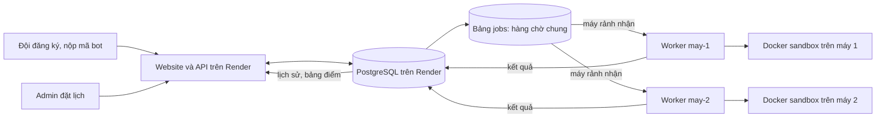

# Oẳn Tù Tì OTTv2 — cuộc thi lập trình bot

Mỗi đội viết một bot bằng **Python 3** hoặc **C++17** cho trò chơi chiến thuật Oẳn Tù Tì trên bàn cờ 9×9. Đội đăng ký tài khoản, nộp mã nguồn trên website và theo dõi trạng thái bài nộp, trận đấu, bảng xếp hạng. Khi đến giờ thi, hệ thống tự ghép các bot; thành viên đội không cần trực tuyến để điều khiển từng nước đi.

## Truy cập sản phẩm

| Mục đích | Địa chỉ |
| --- | --- |
| Website cho đội thi | [oantuti-demo.onrender.com](https://oantuti-demo.onrender.com/) |
| Trang ban tổ chức | [oantuti-demo.onrender.com/admin](https://oantuti-demo.onrender.com/admin) |
| Mã nguồn | [github.com/Ppt05/Laptrinhmang_G8](https://github.com/Ppt05/Laptrinhmang_G8) |

Trang admin dùng để **đặt giờ bắt đầu, kết thúc và xem kết quả**. Admin không chọn cặp đội và không chọn máy chạy trận. Có thể đặt URL website vào ô **About → Website** của repository GitHub; cả hai link sản phẩm đã có trong bảng trên.

## Luồng hoạt động



1. API lưu tài khoản và từng phiên bản mã nguồn vào PostgreSQL, đồng thời tạo job biên dịch.
2. Worker lấy job từ bảng `jobs`, kiểm tra hoặc biên dịch bot trong Docker sandbox. Bài hợp lệ chuyển sang trạng thái `ready`.
3. Trong khoảng thời gian admin đã mở, vào **giờ bắt đầu của mỗi ngày** hệ thống lấy phiên bản `ready` mới nhất của mỗi đội, xáo trộn ngẫu nhiên và ghép cặp. Mỗi đội có tối đa một trận **ghép tự động** mỗi ngày; nếu lẻ đội, một đội nghỉ lượt. Nếu ngày đó đã tạo trận tự động, khởi động lại worker sẽ không tạo trùng.
4. Mỗi trận được đưa vào hàng chờ chung. Worker nào rảnh lấy trước, chạy hai bot trong hai sandbox, áp dụng luật OTTv2 rồi lưu diễn biến và kết quả. PostgreSQL khóa job để hai worker không nhận cùng một trận.
5. Website hiển thị kết quả và bảng xếp hạng từ PostgreSQL. Nếu chỉ một worker bật, nó xử lý lần lượt tất cả job đang chờ. Khi cả hai bật, chúng có thể chạy hai trận song song.

Ví dụ lịch bắt đầu **20:40 ngày 14/10** và kết thúc **20:40 ngày 22/10** theo giờ Việt Nam: hệ thống ghép lúc 20:40 mỗi ngày còn nằm trong lịch. Nếu worker được bật sau giờ ghép của ngày đó, nó sẽ ghép ngay khi kết nối, miễn là chưa có lượt ghép tự động trong ngày.

> **Giới hạn hiện tại:** Nếu máy tắt khi một trận đã ở trạng thái `running`, trận đó chưa được tự động chuyển sang máy khác. Các trận còn ở trạng thái `queued` vẫn được worker còn lại nhận.

## Cấu trúc dự án

```text
oantuti_server/
├── app/
│   ├── main.py                 # FastAPI: tài khoản, bài nộp, kết quả, lịch admin
│   ├── worker.py               # Ghép đội, lấy job, chạy bot, ghi kết quả
│   ├── models.py               # Các bảng PostgreSQL
│   ├── schema.py               # Tạo và nâng cấp cấu trúc bảng
│   ├── event_schedule.py       # Tính trạng thái lịch theo giờ Việt Nam
│   ├── security.py             # Xác thực tài khoản đội
│   └── db.py                   # Kết nối PostgreSQL
├── web/                        # HTML, CSS, JavaScript của website và trang admin
├── sandbox/                    # Image Docker biên dịch và chạy bot
├── examples/                   # Bot ví dụ
├── Dockerfile                  # Image website/API
├── Dockerfile.worker           # Image worker
├── docker-compose.yml          # Chạy đủ hệ thống trên một máy
├── docker-compose.remote-worker.yml  # Worker nối tới Render
├── render.yaml                 # Cấu hình website và PostgreSQL trên Render
├── .env.example                # Mẫu cấu hình chạy local
└── .env.worker.example         # Mẫu cấu hình worker nối Render
```

**Hàng chờ hiện là bảng `jobs` trong PostgreSQL, không dùng Redis.** Các tên như Match Loader, Match Runner, Game Engine, Sandbox Manager mô tả trách nhiệm bên trong `app/worker.py`, chưa phải các dịch vụ triển khai độc lập. Mỗi bot được chạy trong Docker sandbox không có mạng, giới hạn CPU/RAM/thời gian; website/API không chạy mã thí sinh trực tiếp.

## Cách chạy trên máy cá nhân

Cách này tạo **website và cơ sở dữ liệu riêng trên máy**, không dùng dữ liệu cuộc thi đang ở Render.

**Cần có:** Git, Docker Desktop đang chạy ở chế độ Linux containers và PowerShell.

```powershell
git clone https://github.com/Ppt05/Laptrinhmang_G8.git
cd Laptrinhmang_G8
Copy-Item .env.example .env
notepad .env
```

Trong `.env`, thay `POSTGRES_PASSWORD`, `ADMIN_API_KEY`, `ADMIN_PASSWORD` bằng các giá trị riêng. Để chạy trận local, đặt `MATCHES_ENABLED=true`; giữ `AUTO_PAIR_ENABLED=true`. Sau đó:

```powershell
docker compose up --build -d
docker compose ps
```

Mở [http://localhost:8000/](http://localhost:8000/) để đăng ký đội và nộp bot. Mở [http://localhost:8000/admin](http://localhost:8000/admin), đăng nhập bằng `ADMIN_USERNAME` và `ADMIN_PASSWORD` trong `.env`, rồi lưu giờ mở/đóng trận. Lịch phải đang mở và cần ít nhất hai bot ở trạng thái `ready` để tạo trận tự động.

Xem log bằng `docker compose logs -f api worker`. Nhấn `Ctrl+C` chỉ thoát màn hình log. Dừng dịch vụ bằng `docker compose down`; không thêm `-v` nếu muốn giữ dữ liệu PostgreSQL local.

## Chạy worker cho website Render

Website/API và PostgreSQL chạy trên Render. **Worker chạy trên máy của ban tổ chức**, nên phải bật máy, Docker Desktop và Internet trong thời gian cần biên dịch hoặc chạy trận. Người thi chỉ truy cập website Render, không cần kết nối trực tiếp tới máy worker.

### Máy thứ nhất

1. Clone repository như phần trên, hoặc mở thư mục dự án đã có và chạy `git pull --ff-only origin main`.
2. Trong Render Dashboard, mở PostgreSQL của dự án → **Connect** → lấy **External Database URL**. Máy cá nhân không dùng được Internal Database URL.
3. Tại thư mục chứa `docker-compose.remote-worker.yml`, tạo cấu hình riêng:

   ```powershell
   Copy-Item .env.worker.example .env.worker
   notepad .env.worker
   ```

   Dán External Database URL vào `DATABASE_URL`, đặt `WORKER_ID=may-1`, `MATCHES_ENABLED=true`, `AUTO_PAIR_ENABLED=true`. Mỗi máy chỉ cần file `.env.worker` của chính nó; không cần mật khẩu admin.

4. Mở Docker Desktop, chờ Docker Engine chạy rồi thực hiện:

   ```powershell
   docker compose -f docker-compose.remote-worker.yml up --build -d
   docker compose -f docker-compose.remote-worker.yml ps
   docker compose -f docker-compose.remote-worker.yml logs -f worker
   ```

5. Trên Render Web Service `oantuti-demo`, đặt `MATCHES_ENABLED=true` trong **Environment**. Mở trang admin, đặt lịch và xem số worker trực tuyến. `MATCHES_ENABLED` trên Render là cờ cho website/API; cờ trong `.env.worker` là của worker trên máy.

### Máy thứ hai

Bạn cùng nhóm cài Git và Docker Desktop, clone cùng repository, tạo `.env.worker` theo các bước trên, dùng **cùng External Database URL** nhưng đặt `WORKER_ID=may-2`. Sau đó chạy cùng lệnh `docker compose -f docker-compose.remote-worker.yml up --build -d`.

Hai worker dùng chung hàng chờ. Không phải chia sẵn trận cho từng máy: máy nào rảnh sẽ lấy job tiếp theo. `WORKER_ID` chỉ để nhận diện máy nào đã xử lý trận; hai máy không được dùng trùng ID. Muốn dừng một máy:

```powershell
docker compose -f docker-compose.remote-worker.yml down
```

Máy còn lại tiếp tục nhận các job **chưa bắt đầu**. Khi cập nhật mã, trên từng máy chạy `git pull --ff-only origin main`, sau đó chạy lại `up --build -d`. Không để Windows tự Sleep trong lúc thi.

## Đội thi nộp bot như thế nào?

1. Đăng ký tên đội và mật khẩu trên website, sau đó đăng nhập.
2. Chọn **Python 3** hoặc **C++17**, dán mã nguồn vào ô nộp bài. Mỗi lần nộp tạo một phiên bản; giới hạn mã nguồn **100 KB**.
3. Xem trạng thái bài nộp. Hệ thống chỉ dùng phiên bản hợp lệ mới nhất có trạng thái `ready` khi ghép trận.
4. Sau trận, xem lịch sử đấu và bảng xếp hạng trên website. Thắng được 1 điểm, hòa 0,5 điểm, thua 0 điểm.

Bấm **Bảng xếp hạng** trên thanh điều hướng để mở cửa sổ kết quả. **Toàn mùa** cộng điểm mọi trận đã hoàn tất; **Theo ngày** chỉ hiện các trận có ngày ghép tương ứng. Bộ lọc theo ngày không thay đổi bảng điểm toàn mùa.

Ở mỗi lượt, bot đọc **một dòng JSON** từ `stdin`, trong đó có bàn cờ và danh sách `legal_moves`. Bot chọn một nước hợp lệ và in **một dòng JSON** ra `stdout`, ví dụ:

```json
{"piece_id":"S01","to":"a4"}
```

Không in nội dung gỡ lỗi ra `stdout`; chỉ ghi vào `stderr`. Mỗi lượt có tối đa **1,5 giây**. Nước đi sai định dạng, không nằm trong `legal_moves` hoặc trả lời quá giờ sẽ khiến bot thua trận. Xem thư mục [`examples/`](examples/) để bắt đầu viết bot.

### Luật bàn cờ OTTv2

- Bàn 9×9; mỗi bên có 10 quân Đấm, Kéo, Lá; Xanh (South) đi trước.
- Mỗi lượt di chuyển một quân đúng một ô theo một trong tám hướng.
- Đấm ăn Kéo, Kéo ăn Lá, Lá ăn Đấm. Quân cùng loại hoặc quân không bị khắc chế sẽ chặn ô.
- Thắng khi ăn hết một loại quân của đối thủ hoặc đưa quân tới ô đích: Bắc tới `a1`, Nam tới `i9`.
- Hòa nếu lặp cùng thế cờ ba lần, không còn nước hợp lệ hoặc hết giới hạn 200 nước đi.

## Bảo mật và vận hành

- Không đưa `.env`, `.env.worker`, URL PostgreSQL, mật khẩu admin hay token đội lên GitHub. Hai file cấu hình thật đã nằm trong `.gitignore`.
- `ADMIN_USERNAME` mặc định là `admin`; mật khẩu thật nằm trong biến môi trường `ADMIN_PASSWORD` trên Render hoặc `.env` khi chạy local. Người chỉ chạy worker không cần tài khoản admin.
- Worker có quyền tạo Docker sandbox trên máy chủ chạy nó. Chỉ chạy worker trên máy tin cậy của ban tổ chức.
- Trang web báo **Đang mở** khi lịch và `MATCHES_ENABLED` cho phép; trạng thái đó không tự chứng minh worker đang trực tuyến. Trang admin hiển thị số worker đang báo heartbeat. Nếu không có worker, bài nộp và trận sẽ chờ xử lý.

## Cập nhật mã và triển khai

Sau khi sửa mã hoặc tài liệu trong repository:

```powershell
git status
git add README.md app/ web/ .env.example .env.worker.example
git commit -m "Update project documentation"
git push origin main
```

Không thêm `.env` hoặc `.env.worker` vào Git. Nếu Render đang tắt **Auto Deploy**, vào Web Service → **Manual Deploy → Deploy latest commit** để cập nhật website/API. Worker trên mỗi máy được cập nhật riêng bằng `git pull` và `docker compose ... up --build -d`; deploy Render không tự cập nhật worker.
